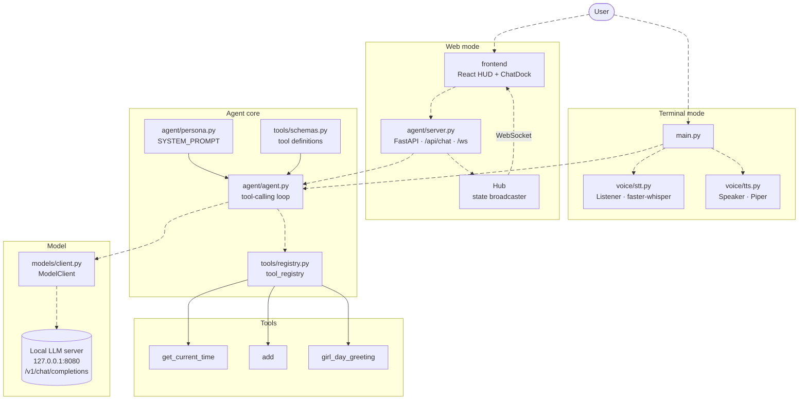

# Sorena Architecture

Sorena is a local AI companion agent. It can be driven from a terminal (`main.py`, with voice in and out) or from a web HUD (React frontend + FastAPI service). Both paths share the same `Agent` loop, tool registry and local model server.

> Animated edges (the moving dashes) need a recent Mermaid version. If your viewer is older, the diagram still renders, just without motion.

## Layers

| Layer | Files | Responsibility |
| --- | --- | --- |
| Entry points | `main.py`, `agent/server.py` | Receive a user message (typed, spoken or from the HUD) and hand it to the agent |
| Voice | `voice/stt.py`, `voice/tts.py` | Speech to text (Whisper) and text to speech (Piper) for terminal mode |
| Agent core | `agent/agent.py`, `agent/persona.py` | Persona prompt plus the loop that alternates between the model and tools |
| Tools | `tools/*.py` | Small Python functions the model can call; `schemas.py` describes them, `registry.py` maps names to code |
| Model | `models/client.py` | One HTTP call to the local OpenAI-compatible server |
| HUD | `frontend/src` | Shows the agent state (idle, listening, working, speaking, success, error) and a chat dock |

## Adding a tool

1. Write the function in `tools/your_tool.py`.
2. Describe it in `tools/schemas.py` so the model knows when to call it.
3. Register it in `tools/registry.py`.

`GET /api/tools` flags any schema that has no matching entry in `tool_registry`.