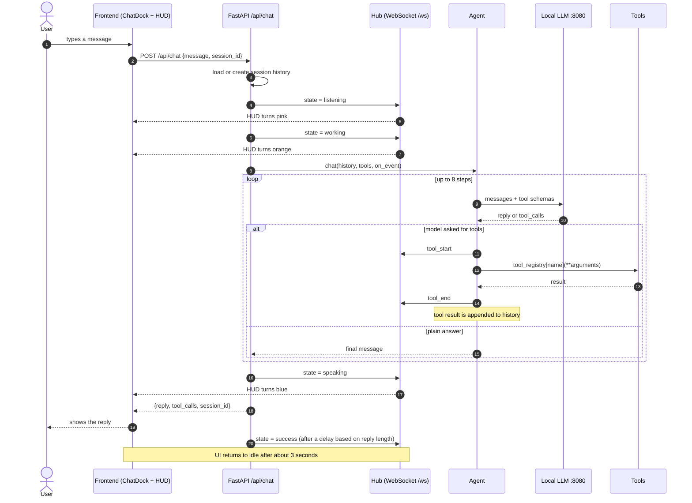
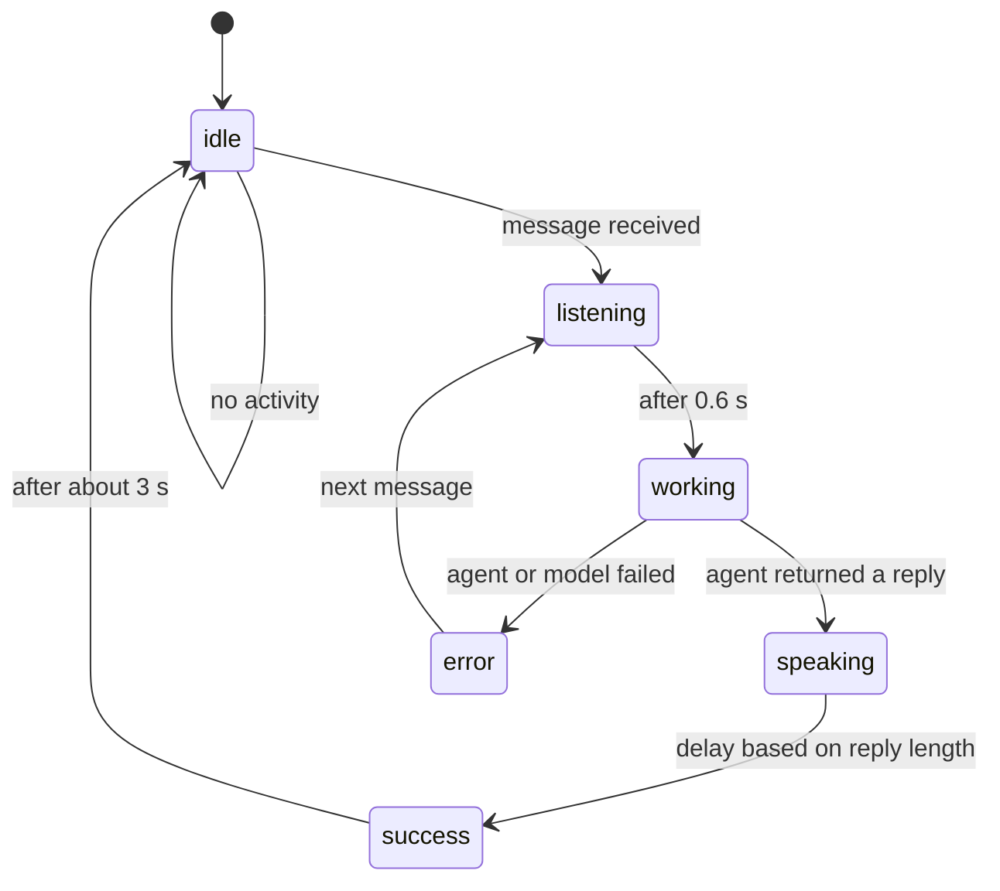
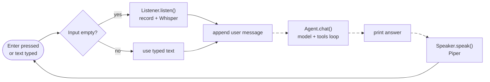

# Yalda Message Flow

How one user message travels through Yalda, and how the HUD state changes along the way.

## Web chat sequence

## HUD state machine

## Terminal mode flow

## Notes

- History lives in memory per `session_id`; if the agent fails, the new turn is rolled back so the history stays clean.
- The loop stops after 8 model-and-tool rounds so a model that keeps calling tools cannot run forever.
- Tool errors are returned to the model as text instead of crashing the request.